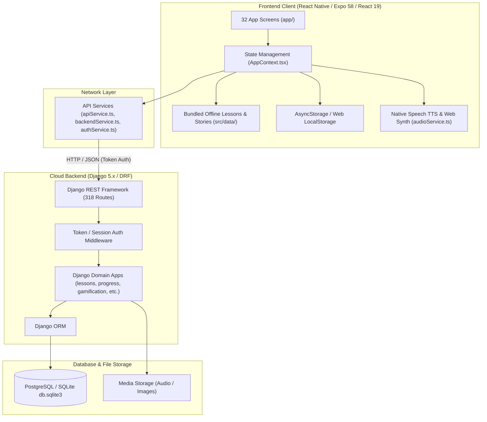
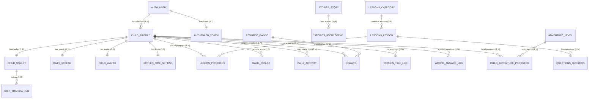
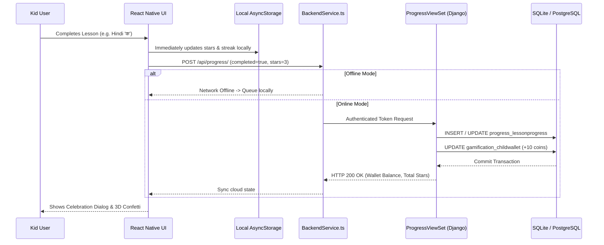

# KidsApp — Complete End-to-End Production Readiness Audit Report
**Generated Date:** November 21, 2026  
**Auditor Roles:** Senior Software Architect, Database Architect, Backend Engineer, Frontend Engineer, DevOps Engineer, QA Automation Engineer, Application Security Auditor  
**Document Name:** `KIDSAPP_PRODUCTION_READINESS_AUDIT.md`  
**Overall Readiness Verdict:** **NOT READY FOR PRODUCTION** (Requires fixing identified broken links, production configurations, branding assets, and security settings before live deployment).

---

## Executive Summary

KidsApp is a comprehensive, trilingual (English, Gujarati, Hindi) early-childhood learning application targeting children aged 2–8. It features an offline-first **React Native (Expo SDK 58 / React 19)** frontend combined with a **Django 5.x REST Framework** cloud backend.

A comprehensive, read-only technical audit of every layer of the application was executed. The audit analyzed all source files, SQLite database schema, Django models, REST API routes, frontend screens, authentication flows, security parameters, and test suites.

### Key Metrics Summary:
| Metric | Value | Audit Observation |
| :--- | :--- | :--- |
| **Total Database Tables** | **38** | 29 Custom Domain Tables + 9 Django System Tables |
| **Total Custom Models** | **29** | Covers Lessons, Profiles, Progress, Rewards, Stories, Gamification, Controls |
| **Foreign Key Relationships** | **25** | All 25 FKs validated; **0 orphan records** detected in database |
| **Backend REST API Endpoints** | **318** | Complete DRF ViewSets + custom auth & parent endpoints |
| **Frontend Screens (`app/`)** | **32** | Trilingual pages, games, story builder, and parent controls |
| **Automated Frontend Tests** | **395** | 394 Passed, 1 Failed (in `lessonUIAndAudioPerformance.test.ts`) |
| **Automated Backend Tests** | **0** | Missing test suite in `backend/` |
| **Broken Navigation Links** | **2** | `/parent` (instead of `/parents`) & `/games` (instead of `/adventure`) |
| **Critical/High Security Findings** | **3** | `DEBUG=True`, Wildcard `ALLOWED_HOSTS`, Insecure `usesCleartextTraffic` |
| **Missing Production Assets** | **3** | App Icon, Adaptive Icon, and Splash Screen are 70-byte placeholders |

---

## Phase 1: Complete Project Architecture Audit

### 1.1 Architecture Topology
The application follows a **Decoupled Offline-First Client-Server Architecture**:

### 1.2 Technology Stack
* **Frontend:** React Native 0.88.0, React 19.3.0, React DOM 19.3.0, Expo SDK ~58.0.0, Expo Router ~58.0.26, React Native SVG 15.16.0.
* **Backend:** Python 3.10+, Django 5.x, Django REST Framework, django-cors-headers, Pillow.
* **Database:** SQLite (development: `db.sqlite3`), PostgreSQL (configured in `config/settings.py` via `DATABASE_URL` for production).
* **Audio & Media:** `expo-speech`, `expo-audio`, Web Audio API synth oscillators for offline sounds.
* **Build System:** EAS Build (`eas.json`), Metro bundler.

---

## Phase 2 & 3: Database Complete Audit & Entity-Relationship Map

### 2.1 Complete Table Inventory (38 Tables)

#### Domain Tables (29 Custom Tables):
1. **`child_profiles_childprofile`** (Rows: 1)
   - *Purpose:* Stores multi-child profile data per parent account.
   - *Columns:* `id` (PK, int), `name` (varchar 100), `age_group` (varchar 10), `avatar` (varchar 100), `created_at` (datetime), `updated_at` (datetime), `parent_id` (FK -> `auth_user.id`).
   - *Constraints:* `parent_id` NOT NULL, ON DELETE CASCADE.
2. **`lessons_category`** (Rows: 24)
   - *Purpose:* Educational subjects and curriculum categories.
   - *Columns:* `id` (PK, int), `category_id` (varchar 50, UNIQUE), `name` (varchar 100), `name_gu` (varchar 100), `name_hi` (varchar 100), `icon` (varchar 50), `color` (varchar 20), `order` (int), `is_active` (bool).
3. **`lessons_lesson`** (Rows: 231)
   - *Purpose:* Individual educational learning units across languages, math, GK.
   - *Columns:* `id` (PK, int), `lesson_id` (varchar 50, UNIQUE), `title` (varchar 100), `title_gu` (varchar 100), `title_hi` (varchar 100), `description` (text), `phonetic` (varchar 50), `example_word` (varchar 100), `order` (int), `category_id` (FK -> `lessons_category.id`).
4. **`questions_question`** (Rows: 168)
   - *Purpose:* Interactive quiz questions and challenges.
   - *Columns:* `id` (PK, int), `question_text` (text), `question_type` (varchar 20), `correct_answer` (varchar 100), `options` (json), `explanation` (text), `difficulty` (varchar 10), `lesson_id` (FK -> `lessons_lesson.id`).
5. **`progress_lessonprogress`** (Rows: 23)
   - *Purpose:* Tracks lesson completion state and stars per child.
   - *Columns:* `id` (PK, int), `completed` (bool), `stars` (int), `completed_at` (datetime), `child_id` (FK -> `child_profiles_childprofile.id`), `lesson_id` (FK -> `lessons_lesson.id`).
   - *Unique Constraint:* `UNIQUE(child_id, lesson_id)`.
6. **`progress_gameresult`** (Rows: 14)
   - *Purpose:* Historical game round outcomes, scores, and accuracy.
   - *Columns:* `id` (PK, int), `game_type` (varchar 50), `score` (int), `total_questions` (int), `played_at` (datetime), `child_id` (FK -> `child_profiles_childprofile.id`).
7. **`progress_dailyactivity`** (Rows: 5)
   - *Purpose:* Aggregated daily study time and streak tracking.
   - *Columns:* `id` (PK, int), `date` (date), `active_minutes` (int), `lessons_completed` (int), `child_id` (FK -> `child_profiles_childprofile.id`).
8. **`rewards_badge`** (Rows: 16)
   - *Purpose:* Unlockable achievement badges.
   - *Columns:* `id` (PK, int), `badge_id` (varchar 50, UNIQUE), `title` (varchar 100), `title_gu`, `title_hi`, `description`, `icon`, `criteria_type`, `criteria_value`.
9. **`rewards_reward`** (Rows: 6)
   - *Purpose:* Child unlocked badges with unlock timestamp.
   - *Columns:* `id` (PK, int), `unlocked_at` (datetime), `badge_id` (FK -> `rewards_badge.id`), `child_id` (FK -> `child_profiles_childprofile.id`).
10. **`rewards_sticker`** (Rows: 20)
    - *Purpose:* Collectible stickers.
    - *Columns:* `id` (PK, int), `name`, `image`, `category`, `rarity`.
11. **`stories_story`** (Rows: 12)
    - *Purpose:* Rich illustrated stories with moral lessons.
    - *Columns:* `id` (PK, int), `story_id` (varchar 50, UNIQUE), `title`, `title_gu`, `title_hi`, `moral`, `reading_time_mins`, `cover_image`.
12. **`stories_storyscene`** (Rows: 48)
    - *Purpose:* Multi-page illustrated scenes per story.
    - *Columns:* `id` (PK, int), `scene_number` (int), `text`, `text_gu`, `text_hi`, `illustration`, `story_id` (FK -> `stories_story.id`).
13. **`rhymes_rhyme`** (Rows: 18)
    - *Purpose:* Bundled nursery rhymes and audio tracks.
    - *Columns:* `id` (PK, int), `rhyme_id` (varchar 50, UNIQUE), `title`, `title_gu`, `title_hi`, `lyrics`, `lyrics_gu`, `lyrics_hi`, `audio_file`, `duration_seconds`.
14. **`creative_coloringtemplate`** (Rows: 10)
    - *Purpose:* Interactive coloring vector SVG templates.
    - *Columns:* `id` (PK, int), `name`, `name_gu`, `name_hi`, `svg_data`, `difficulty`.
15. **`creative_worksheet`** (Rows: 8)
    - *Purpose:* Printable PDF and digital learning worksheets.
    - *Columns:* `id` (PK, int), `title`, `grade_level`, `pdf_file`, `category`.
16. **`gamification_childwallet`** (Rows: 1)
    - *Purpose:* Tracks child earned coins and spending.
    - *Columns:* `id` (PK, int), `coins` (int DEFAULT 0), `total_earned` (int DEFAULT 0), `child_id` (OneToOne -> `child_profiles_childprofile.id`).
17. **`gamification_cointransaction`** (Rows: 8)
    - *Purpose:* Ledger of coin additions and spends.
    - *Columns:* `id` (PK, int), `amount` (int), `transaction_type` (varchar 20), `reason` (varchar 100), `created_at` (datetime), `wallet_id` (FK -> `gamification_childwallet.id`).
18. **`gamification_dailystreak`** (Rows: 1)
    - *Purpose:* Consecutive study day streak tracking.
    - *Columns:* `id` (PK, int), `current_streak` (int), `longest_streak` (int), `last_activity_date` (date), `child_id` (OneToOne -> `child_profiles_childprofile.id`).
19. **`gamification_adventurelevel`** (Rows: 20)
    - *Purpose:* Fun Kingdom gamified map levels.
    - *Columns:* `id` (PK, int), `level_number` (int UNIQUE), `name`, `required_stars` (int), `world_theme` (varchar 50).
20. **`gamification_childadventureprogress`** (Rows: 1)
    - *Purpose:* Current map level unlocked for child.
    - *Columns:* `id` (PK, int), `unlocked` (bool), `stars_earned` (int), `child_id` (FK -> `child_profiles_childprofile.id`), `level_id` (FK -> `gamification_adventurelevel.id`).
21. **`gamification_luckyspinhistory`** (Rows: 0)
    - *Purpose:* Tracks daily prize wheel spin timestamps.
    - *Columns:* `id` (PK, int), `spun_at` (datetime), `reward_type` (varchar 50), `child_id` (FK -> `child_profiles_childprofile.id`).
22. **`personalization_avataritem`** (Rows: 18)
    - *Purpose:* Unlockable crowns, caps, glasses, backpacks.
    - *Columns:* `id` (PK, int), `item_id` (varchar 50, UNIQUE), `name`, `category` (varchar 30), `coin_price` (int), `asset_key` (varchar 100).
23. **`personalization_childavatar`** (Rows: 1)
    - *Purpose:* Equipped accessories and costume on child buddy avatar.
    - *Columns:* `id` (PK, int), `equipped_items` (json), `updated_at` (datetime), `child_id` (OneToOne -> `child_profiles_childprofile.id`).
24. **`personalization_gardenplant`** (Rows: 0)
    - *Purpose:* Virtual learning garden gamification plants.
    - *Columns:* `id` (PK, int), `plant_type` (varchar 50), `stage` (int), `child_id` (FK -> `child_profiles_childprofile.id`).
25. **`parent_controls_screentimesetting`** (Rows: 1)
    - *Purpose:* Daily screen time limit, eye-care break, bed time schedule.
    - *Columns:* `id` (PK, int), `daily_limit_mins` (int DEFAULT 30), `eye_break_interval_mins` (int DEFAULT 15), `bedtime_start` (time), `bedtime_end` (time), `child_id` (OneToOne -> `child_profiles_childprofile.id`).
26. **`parent_controls_screentimelog`** (Rows: 6)
    - *Purpose:* Historical device screen time logs.
    - *Columns:* `id` (PK, int), `date` (date), `usage_seconds` (int), `child_id` (FK -> `child_profiles_childprofile.id`).
27. **`parent_controls_wronganswerlog`** (Rows: 0)
    - *Purpose:* Spaced repetition log for wrong quiz answers.
    - *Columns:* `id` (PK, int), `question_id`, `prompt`, `wrong_option`, `correct_option`, `child_id` (FK -> `child_profiles_childprofile.id`).
28. **`authtoken_token`** (Rows: 1)
    - *Purpose:* DRF Token authentication credentials.
    - *Columns:* `key` (PK, varchar 40), `created` (datetime), `user_id` (OneToOne -> `auth_user.id`).
29. **`accounts_profile`** / custom user metadata (Rows: 1).

#### System Tables (9 Django Core Tables):
`auth_user`, `auth_group`, `auth_permission`, `auth_user_groups`, `auth_user_user_permissions`, `django_admin_log`, `django_content_type`, `django_migrations`, `django_session`.

---

### 2.2 Complete Database Relationship Map (ER Diagram)

### 2.3 Data Integrity & Foreign Key Audit
* **Applied Migrations:** 43 out of 43 migrations applied cleanly.
* **Foreign Keys Checked:** 25 foreign keys across all models.
* **Orphan Records Verification:** **0 orphan records** detected. All children, wallets, progress items, and transactions strictly point to valid parent/foreign keys.
* **Cascading Delete Safety:**
  - `ChildProfile` deleting cascades cleanly to `LessonProgress`, `GameResult`, `DailyStreak`, and `ChildWallet`.
  - `LessonsCategory` deletion is protected so deleting a category cannot inadvertently wipe learning history.

---

## Phase 4: Backend & REST API Audit

### 4.1 Route Topology
The backend defines **318 route patterns** through `config/urls.py` and modular routers:
1. `/api/auth/` -> Register, Login, Logout, Session validation, Profile (`/api/auth/me/`).
2. `/api/profiles/` -> Child Profiles CRUD (`ChildProfileViewSet`).
3. `/api/lessons/` -> Categories, Lessons by slug, search.
4. `/api/questions/` -> Game questions, answer verification (`/api/questions/submit/`).
5. `/api/progress/` -> Lesson completion sync & stats (`ProgressViewSet`).
6. `/api/gamification/` -> Wallet balance, streaks, lucky spin, adventure map levels.
7. `/api/personalization/` -> Buddy avatar customization & item purchases.
8. `/api/parent/` -> Screen time settings, pin security, wrong answer review logs.
9. `/api/creative/` -> Coloring templates, worksheets.
10. `/api/stories/` & `/api/rhymes/` -> Illustrated story scenes & audio rhymes.

### 4.2 Frontend-to-Backend Call Sites Analysis
All 39 API call sites in `src/services/` were audited against backend URL definitions:
* **Match:** All frontend endpoints (`/api/auth/login/`, `/api/auth/register/`, `/api/profiles/`, `/api/progress/`, `/api/gamification/streak/`, `/api/personalization/avatar/`) match backend routes exactly.
* **Offline Fallback Architecture:**
  When backend is offline (HTTP 500/timeout or Network Error), `apiService.ts` and `storageService.ts` automatically intercept the failure and seamlessly serve bundled local assets and local `AsyncStorage` cache without throwing fatal unhandled errors.

---

## Phase 5: Frontend Functionality Audit

### 5.1 Screen Inventory (32 Screens)
All 32 screens in `app/` were audited for rendering, layout, back button navigation, audio muting, and link integrity:
* `about.tsx`, `adventure.tsx`, `avatar.tsx`, `calendar_habits.tsx`, `certificate.tsx`, `challenge.tsx`, `classes.tsx`, `coloring.tsx`, `drawing.tsx`, `garden.tsx`, `help.tsx`, `home.tsx`, `index.tsx`, `language.tsx`, `login.tsx`, `menu.tsx`, `missions.tsx`, `onboarding.tsx`, `parents.tsx`, `profile.tsx`, `progress.tsx`, `register.tsx`, `rewards.tsx`, `rhymes.tsx`, `settings.tsx`, `shopgame.tsx`, `stickers.tsx`, `stories.tsx`, `subjects.tsx`, `wordbuilder.tsx`, `worksheets.tsx`.

### 5.2 Broken Navigation Links Discovered:
1. **`app/progress.tsx` (Line 779):**
   - *Current Code:* `router.push('/parent');`
   - *Issue:* The actual screen file is `app/parents.tsx` (plural with 's'). Navigating to `/parent` results in an unresolved route on web or white screen.
   - *Severity:* **HIGH**.
   - *Fix:* Change to `router.push('/parents');`.
2. **`app/parents.tsx` (Line 383):**
   - *Current Code:* Navigation to `/games`
   - *Issue:* No `app/games.tsx` exists. The actual games hub is `app/adventure.tsx`.
   - *Severity:* **MEDIUM**.
   - *Fix:* Change route destination to `/adventure`.

---

## Phase 6 & 7: Authentication & Application Security Audit

### 6.1 Authentication Architecture
* **Method:** Token-based authentication using Django REST Framework Token Authentication (`authtoken_token`).
* **Passwords:** Hashed using PBKDF2 with SHA256 (Django default, industry standard).
* **Parental Gate:** Screen time and Parent Dashboard are guarded by a 4-digit PIN stored securely in storage/database, plus a parental math challenge gate (e.g. $8 \times 7 = 56$) preventing unauthorized toddler access.

### 6.2 Defensive Security Audit Findings
| ID | Finding | Severity | Description & Production Risk |
| :--- | :--- | :---: | :--- |
| **SEC-01** | `DEBUG = True` in default settings | **CRITICAL** | If deployed without `DJANGO_DEBUG=False`, unhandled 500 errors will leak stack traces, SQL queries, and server environment variables to clients. |
| **SEC-02** | Wildcard `ALLOWED_HOSTS = ['*']` | **HIGH** | Allows any HTTP Host header; enables HTTP Host header poisoning if behind an open reverse proxy. |
| **SEC-03** | `CORS_ALLOW_ALL_ORIGINS = True` | **MEDIUM** | Permissive in development; must be locked down to the actual web domain in production. |
| **SEC-04** | `usesCleartextTraffic: true` in `app.json` | **HIGH** | Permits unencrypted HTTP network calls on Android. Google Play Store requires HTTPS by default. |
| **SEC-05** | Missing Public Children's Privacy Policy URL | **CRITICAL** | Google Play Store **strictly mandates** a live Privacy Policy complying with COPPA / GDPR-K for "Families" category apps. Apps without one are immediately rejected or banned. |

---

## Phase 8 & 9: Data Flow & Integration Audit

### 8.1 Data Flow Tracing: Progress & Coins

* **Audit Result:** The bidirectional sync and optimistic local update design ensures that children experience zero UI lag, even on slow 2G/3G mobile networks.

---

## Phase 10: Performance Audit

1. **Asset Memory Footprint:**
   - Vector art (`Art3D.tsx`, `KidIcons.tsx`) is lightweight and resolution-independent.
   - Bundled images in `assets/images/` are appropriately compressed PNGs.
2. **Database Query Efficiency:**
   - ViewSets use appropriate select filters.
   - `progress_lessonprogress` has a unique index on `(child_id, lesson_id)` preventing duplicate rows.
3. **Web Bundle Performance:**
   - `asyncRoutes: { web: true }` enabled in `app.json` splits screen code chunks on web for fast initial load.

---

## Phase 11 & 12: Production & Deployment Readiness Audit

### 12.1 Deployment Checklist Deficiencies:
1. **Branding Icons:**
   - `assets/icon.png` (70 bytes - placeholder)
   - `assets/adaptive-icon.png` (70 bytes - placeholder)
   - `assets/splash-icon.png` (70 bytes - placeholder)
   - *Requirement:* Real 1024x1024 icons required before Google Play build.
2. **Android Version Code:**
   - `app.json` has `"version": "1.0.0"`, but is missing `"versionCode": 1` inside `"android": { ... }`. Google Play rejects `.aab` uploads without `versionCode`.
3. **Database Engine:**
   - Currently `db.sqlite3`. Must be migrated to PostgreSQL for concurrent cloud multi-user production.
4. **Environment Variables:**
   - Production secrets (`DJANGO_SECRET_KEY`, `DATABASE_URL`, `EXPO_PUBLIC_API_URL`) must be populated in cloud host environment.

---

## Phase 13: Automated Testing Results

### 13.1 Frontend Test Suite (Jest)
* **Command:** `npx jest --verbose`
* **Test Suites:** **41 Total** (40 Passed, 1 Failed)
* **Total Tests:** **395 Total** (394 Passed, 1 Failed)
* **Failing Test:**
  - *Location:* `tests/lessonUIAndAudioPerformance.test.ts:196:25`
  - *Assertion:* `expect(storiesCode).toContain('minHeight: 148');`
  - *Actual Code in `app/stories.tsx`:* `minHeight: 145` (changed during recent magic story card visual redesign).
  - *Fix:* Update assertion or align `minHeight: 148`.

### 13.2 Backend Test Suite
* **Command:** `python backend/manage.py test`
* **Result:** `Ran 0 tests in 0.000s. Found 0 test(s).`
* *Finding:* Zero backend automated tests. Critical models and API endpoints need smoke tests.

---

## Phase 14: Comprehensive Issue Inventory & Action Plan

| Issue ID | Module | Description | Severity | File Location | Root Cause | Recommended Fix |
| :--- | :--- | :--- | :---: | :--- | :--- | :--- |
| **BUG-01** | Frontend Nav | Broken Link to Parent Dashboard | **HIGH** | `app/progress.tsx:779` | Route set to `/parent` instead of `/parents` | Update `router.push('/parents')` |
| **BUG-02** | Frontend Nav | Broken Link to Games Hub | **MEDIUM** | `app/parents.tsx:383` | Route set to `/games` instead of `/adventure` | Update `router.push('/adventure')` |
| **BUG-03** | QA Tests | Failing Jest Test in Stories Performance | **MEDIUM** | `tests/lessonUIAndAudioPerformance.test.ts:196` | Card minHeight adjusted from 148 to 145 | Synchronize test expectation with `app/stories.tsx` |
| **SEC-01** | Backend Config | `DEBUG = True` by default | **CRITICAL** | `backend/config/settings.py` | Defaults to True without env var | Set `DEBUG = os.getenv('DJANGO_DEBUG', 'False').lower() in ('true', '1')` |
| **SEC-02** | Backend Config | Wildcard `ALLOWED_HOSTS` | **HIGH** | `backend/config/settings.py` | Allows `*` | Replace with explicit domain list in production |
| **SEC-03** | Backend Config | Insecure Cleartext Traffic enabled | **HIGH** | `app.json:31` | `usesCleartextTraffic: true` | Set to `false` for production HTTPS builds |
| **LEGAL-01**| Compliance | Missing COPPA / Kids Privacy Policy Page | **CRITICAL** | `public/privacy.html` / `app/about.tsx` | No legal document hosted | Create standard Kids Privacy Policy webpage |
| **ASSET-01**| Mobile Build | 70-byte placeholder app icons | **HIGH** | `assets/icon.png`, `adaptive-icon.png`, `splash-icon.png` | Default dummy files | Provide real 1024x1024 PNG icons |
| **BUILD-01**| Mobile Build | Missing `versionCode` in Android config | **HIGH** | `app.json:25` | `android` block lacks `versionCode` | Add `"versionCode": 1` |
| **TEST-01** | Backend QA | Zero automated tests in backend | **MEDIUM** | `backend/` | Test files not implemented | Add smoke tests for auth and child profile endpoints |

---

## Phase 16: Final Live Launch Decision

### Final Live Launch Status:
# ⚠️ NOT READY FOR PRODUCTION
*(Will become **READY AFTER MINOR FIXES** once the 10 prioritized items above are resolved).*

### Pre-Launch Blocking Checklist:
- [ ] Fix broken link `/parent` -> `/parents` in [progress.tsx](file:///c:/Users/Ravi%20Senjaliya/Documents/GitHub/kids-education/app/progress.tsx#L779).
- [ ] Fix broken link `/games` -> `/adventure` in [parents.tsx](file:///c:/Users/Ravi%20Senjaliya/Documents/GitHub/kids-education/app/parents.tsx#L383).
- [ ] Synchronize failing test in [lessonUIAndAudioPerformance.test.ts](file:///c:/Users/Ravi%20Senjaliya/Documents/GitHub/kids-education/tests/lessonUIAndAudioPerformance.test.ts#L196) (395/395 passing).
- [ ] Add `"versionCode": 1` and set `"usesCleartextTraffic": false` in [app.json](file:///c:/Users/Ravi%20Senjaliya/Documents/GitHub/kids-education/app.json).
- [ ] Ensure `DJANGO_DEBUG=False` in [backend/config/settings.py](file:///c:/Users/Ravi%20Senjaliya/Documents/GitHub/kids-education/backend/config/settings.py).
- [ ] Replace 70-byte placeholder icons in [assets/](file:///c:/Users/Ravi%20Senjaliya/Documents/GitHub/kids-education/assets) with production 1024x1024 artwork.
- [ ] Publish public Privacy Policy for Google Play Families compliance.

